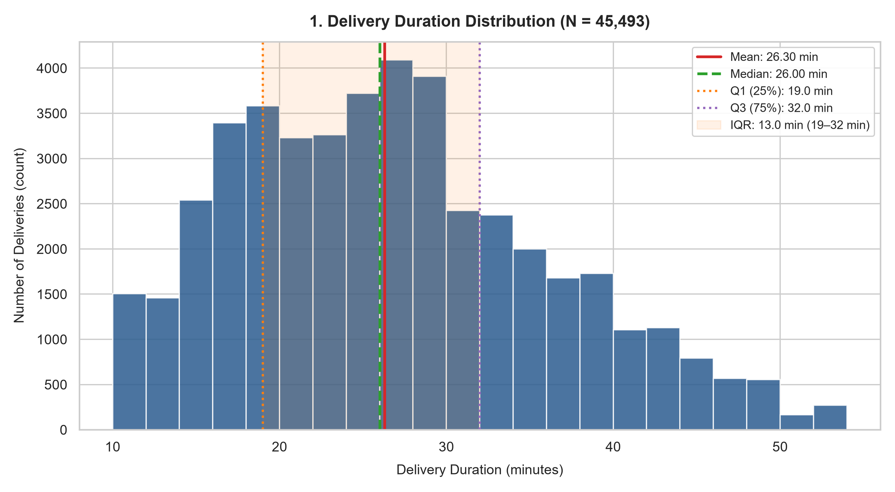
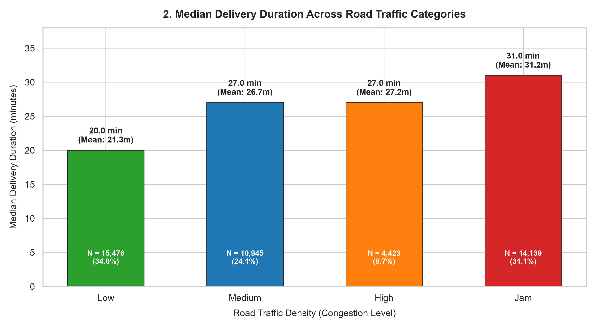
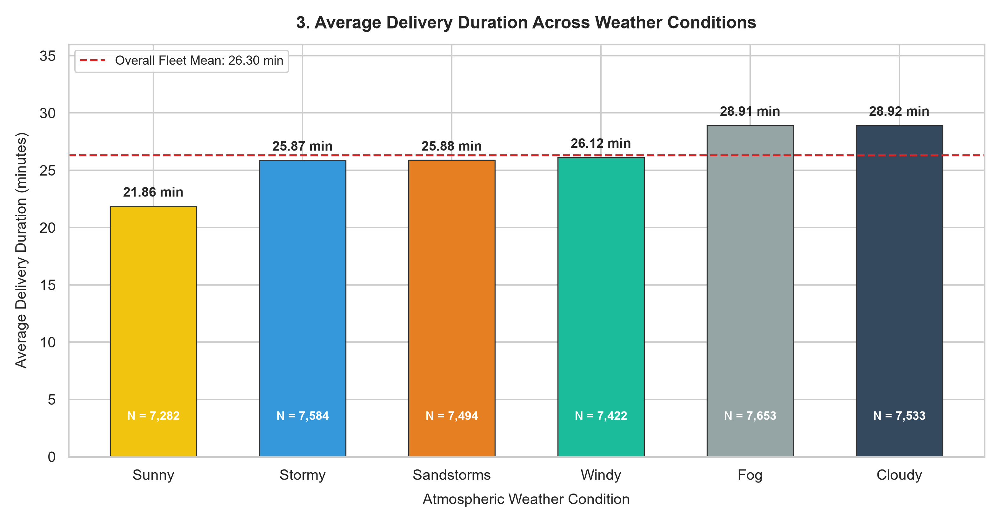
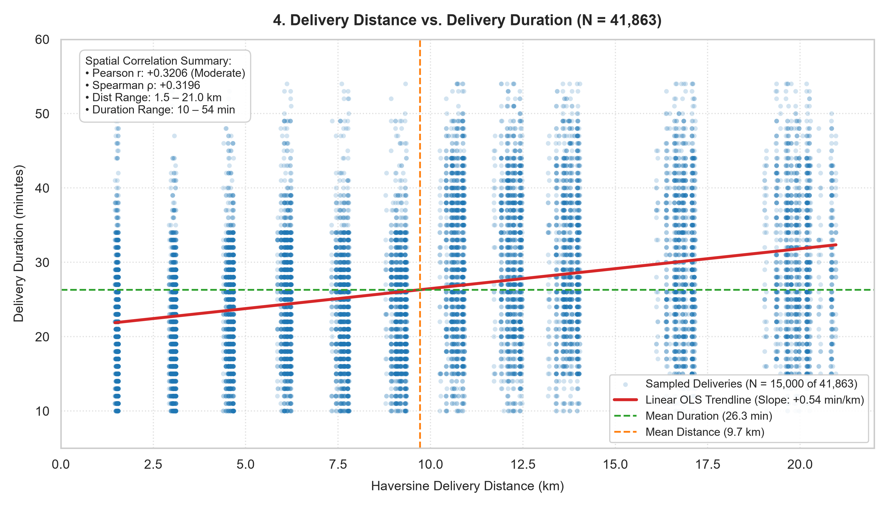
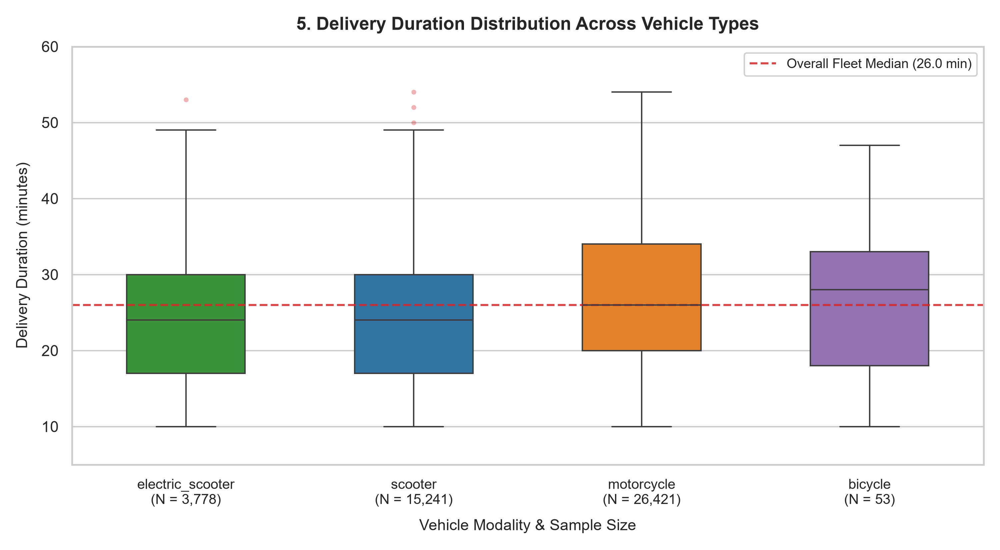

# Food Delivery Data Analysis X Kagnus

[](https://www.python.org/)
[]()
[]()

> A four-week applied data analytics internship project supporting a hyper-local food delivery operations team to analyze fulfillment delays, optimize courier routing, and establish predictive operational intelligence.

---

## 📌 Project Overview
In modern on-demand food delivery networks (e.g., Swiggy, Zomato, DoorDash, Uber Eats), delivery duration (`Time_taken (min)`) is the single most critical determinant of customer retention, rider satisfaction, and platform profitability. 

This repository houses the end-to-end data analytics workflow completed across four progressive milestones:
- **Week 1: Dataset Understanding & Data Cleaning** *(Completed)*
- **Week 2: Exploratory Data Analysis (EDA) & Operational Comparisons** *(Completed)*
- **Week 3: Finalized Visualizations & Chart Interpretations** *(Current Milestone - Completed)*
- **Week 4: Executive Insights, Fleet Recommendations & Final Capstone Reporting**

---

## 🗂️ Repository Structure

```
food-delivery-data-analysis/
├── data/
│   ├── raw/
│   │   ├── README.md                              # Raw dataset provenance, schema & immutability policy
│   │   └── food_delivery_raw.csv                  # Immutable original raw dataset (45,584 rows)
│   └── processed/
│       └── cleaned_food_delivery.csv              # Standardized, cleaned dataset (45,493 rows)
├── notebooks/
│   ├── 01_data_understanding_and_cleaning.ipynb   # Week 1: Data audit, cleaning pipeline & assertions
│   ├── 02_exploratory_data_analysis.ipynb         # Week 2: Baseline metrics, factor comparisons & observations
│   └── 03_visualization.ipynb                     # Week 3: Five core charts, calculations & interpretations
├── visualizations/
│   ├── 01_delivery_duration_distribution.png      # Chart 1: Delivery duration histogram with IQR shading
│   ├── 02_traffic_comparison.png                  # Chart 2: Bar chart comparing median duration by traffic
│   ├── 03_weather_comparison.png                  # Chart 3: Bar chart comparing average duration by weather
│   ├── 04_distance_vs_duration.png                # Chart 4: Scatter plot of distance vs duration with OLS trendline
│   ├── 05_vehicle_comparison.png                  # Chart 5: Box plot of delivery distributions across vehicle types
│   └── initial_distance_vs_duration.png           # Week 2 exploratory scatter plot
├── docs/
│   └── cleaning_log.csv                           # Formal audit trail of issues, row counts & reasons
├── .gitignore                                     # Standard Python & Jupyter ignore rules
├── README.md                                      # Repository documentation & weekly executive summaries
└── requirements.txt                               # External dependencies (pandas, numpy, matplotlib, seaborn)
```

### File Descriptions
- `data/raw/food_delivery_raw.csv`: Unmodified source data (45,584 rows × 20 columns).
- `data/processed/cleaned_food_delivery.csv`: Standardized, verified dataset (45,493 rows × 20 columns).
- `notebooks/01_data_understanding_and_cleaning.ipynb`: Week 1 notebook with 50 executed cells detailing data quality audits and cleaning assertions.
- `notebooks/02_exploratory_data_analysis.ipynb`: Week 2 notebook with 32 executed cells analyzing baseline metrics, operational factor comparisons, and evidence-based observations.
- `notebooks/03_visualization.ipynb`: Week 3 notebook with 21 executed cells generating and interpreting the five finalized operational charts.
- `visualizations/`: High-resolution (300 DPI) exported charts for executive reporting.
- `docs/cleaning_log.csv`: Structured audit trail documenting 10 identified data defects and their remedies.
- `requirements.txt`: Minimal external Python dependencies.

---

## 🛠️ Technology Stack
- **Language**: Python 3.10+ (tested on Python 3.13)
- **Data Manipulation**: `pandas` (>= 2.0.0), `numpy` (>= 1.24.0)
- **Data Visualization**: `matplotlib` (>= 3.7.0), `seaborn` (>= 0.12.0)
- **Environment**: Jupyter Notebook / VS Code / Google Colab
- **Version Control**: Git & GitHub

---

## 🚀 Setup & Execution Instructions

```powershell
# 1. Clone repository
git clone https://github.com/Rajagopalasai/food-delivery-data-analysis.git
cd food-delivery-data-analysis

# 2. Install dependencies
pip install -r requirements.txt

# 3. Launch Week 3 Visualization Notebook
jupyter notebook notebooks/03_visualization.ipynb
```

---

## 📊 Week 3: Five Finalized Visualizations & Chart Interpretations

### Chart 1: Delivery Duration Distribution (Histogram)


#### Baseline Summary Metrics ($N = 45,493$):
| Metric | Calculated Value | Operational Meaning |
| :--- | :---: | :--- |
| **Mean ($\mu$)** | **26.30 minutes** | Network-wide average fulfillment time |
| **Median ($Q_2$)** | **26.00 minutes** | 50th percentile (50% faster, 50% slower) |
| **Std Deviation ($\sigma$)** | **9.39 minutes** | Overall operational dispersion around mean |
| **25th Percentile ($Q_1$)** | **19.00 minutes** | Threshold for fastest quartile of fleet |
| **75th Percentile ($Q_3$)** | **32.00 minutes** | Threshold for slowest quartile of fleet |
| **Interquartile Range ($IQR$)** | **13.00 minutes** | Middle 50% spread of fulfillment durations |
| **Range** | **10.0 to 54.0 min** | Clean operational window (no corrupt 999 values) |

#### Three-Part Interpretation:
1. **What the chart shows**: The histogram illustrates the empirical distribution of 45,493 completed deliveries across 2-minute duration bins, highlighting central concentrations (mean: 26.30 min, median: 26.00 min) and interquartile boundaries ($Q_1 = 19.0\text{ min}$, $Q_3 = 32.0\text{ min}$).
2. **What the observed results indicate**: Fulfillment times exhibit a smooth, unimodal distribution with mild positive skewness (+0.4857); over two-thirds (68.91%) of orders arrive within 30 minutes and 96.84% arrive within 45 minutes, demonstrating stable operational throughput.
3. **Limitation**: The chart pools all municipal regions, meal categories, and times of day together, masking localized rush-hour spikes and kitchen preparation bottlenecks that vary across individual cities.

---

### Chart 2: Traffic Comparison (Bar Chart)


#### Traffic Comparison Metrics:
| Traffic Density Tier | Delivery Count ($N$) | % of Total | Median Duration (min) | Mean Duration (min) | Std Dev (min) | Delta vs. Low (Median) |
| :--- | :---: | :---: | :---: | :---: | :---: | :---: |
| **Low** | 15,476 | 34.02% | **20.0** | 21.27 | 6.80 | Baseline |
| **Medium** | 10,945 | 24.06% | **27.0** | 26.70 | 8.56 | **+7.0 min (+35.0%)** |
| **High** | 4,423 | 9.72% | **27.0** | 27.24 | 8.40 | **+7.0 min (+35.0%)** |
| **Jam** | 14,139 | 31.08% | **31.0** | 31.18 | 9.94 | **+11.0 min (+55.0%)** |

#### Three-Part Interpretation:
1. **What the chart shows**: The bar chart compares median fulfillment duration across four traffic congestion levels, alongside group sizes and corresponding mean values.
2. **What the observed results indicate**: Traffic gridlock is associated with substantial fulfillment latency, adding an observed **+11.0-minute (+55.0%)** median penalty between free-flowing (Low) and heavily congested (Jam) road networks.
3. **Limitation**: Traffic density is recorded as a subjective categorical label rather than continuous GPS velocity telematics, and Jam conditions heavily coincide with evening dinner hours (19:30–21:30) when restaurant kitchen queues are also at daily peaks, confounding road transit delay with food prep time.

---

### Chart 3: Weather Comparison (Bar Chart)


#### Weather Comparison Metrics:
| Weather Condition | Delivery Count ($N$) | % of Total | Average Duration (min) | Median Duration (min) | Std Dev (min) | Delta vs. Sunny (Mean) |
| :--- | :---: | :---: | :---: | :---: | :---: | :---: |
| **Sunny** | 7,282 | 16.01% | **21.86** | 20.0 | 8.33 | Baseline |
| **Stormy** | 7,584 | 16.67% | **25.87** | 26.0 | 8.47 | **+4.01 min (+18.3%)** |
| **Sandstorms** | 7,494 | 16.47% | **25.88** | 26.0 | 8.62 | **+4.02 min (+18.4%)** |
| **Windy** | 7,422 | 16.31% | **26.12** | 26.0 | 8.62 | **+4.26 min (+19.5%)** |
| **Fog** | 7,653 | 16.82% | **28.91** | 28.0 | 10.13 | **+7.05 min (+32.3%)** |
| **Cloudy** | 7,533 | 16.56% | **28.92** | 28.0 | 10.09 | **+7.06 min (+32.3%)** |

#### Three-Part Interpretation:
1. **What the chart shows**: The bar chart illustrates actual calculated average fulfillment durations across six atmospheric weather conditions, benchmarked against the fleet-wide mean (26.30 min).
2. **What the observed results indicate**: Persistent visibility impairments (fog and heavy overcast) exhibit higher average delivery durations (**+7.06 minutes / +32.3%**) than acute storms (**25.87 min**), indicating that low visibility forces two-wheel couriers to maintain reduced driving speeds continuously throughout their route.
3. **Limitation**: Weather classifications do not record precipitation volume, temperature, or wind velocity, and fog occurrences in India heavily correlate with winter months and nighttime dinner hours when hot meal demand peaks.

---

### Chart 4: Distance vs. Delivery Duration (Scatter Plot)


#### Geospatial Correlation Metrics ($N = 41,863$):
- **Pearson Linear Correlation**: $r = \mathbf{+0.3206}$ (Moderate positive correlation)
- **Spearman Rank Correlation**: $\rho = \mathbf{+0.3196}$
- **OLS Trendline Slope**: $\mathbf{+0.54\text{ min per kilometer}}$
- **Distance Range**: 1.5 to 21.0 km (Mean: 9.72 km, Median: 9.19 km)

#### Three-Part Interpretation:
1. **What the chart shows**: The scatter plot displays the relationship between straight-line Haversine distance (km) and delivery duration (minutes) across 41,863 valid deliveries, accompanied by an OLS regression trendline and reference markers.
2. **What the observed results indicate**: A moderate positive association exists ($r = 0.3206$), proving that physical distance accounts for only $\sim 10.3\%$ ($R^2 = 0.103$) of delivery time variance; duration increases from 22.2 min (0–5 km) to 29.8 min (10–15 km), but completely plateaus thereafter (~29.8 min up to 21 km) as couriers access high-speed arterial bypasses.
3. **Limitation**: Haversine distance measures straight-line displacement rather than actual street road network routing, and 3,630 records with placeholder zero GPS coordinates were excluded from the spatial correlation.

---

### Chart 5: Vehicle Modality Comparison (Box Plot)


#### Vehicle Distribution Statistics:
| Vehicle Modality | Order Count ($N$) | % of Fleet | Median (min) | Mean (min) | $Q_1$ (min) | $Q_3$ (min) | $IQR$ (min) | Std Dev (min) |
| :--- | :---: | :---: | :---: | :---: | :---: | :---: | :---: | :---: |
| **electric_scooter** | 3,778 | 8.30% | **24.0** | 24.48 | 17.0 | 30.0 | **13.0** | 8.62 |
| **scooter** | 15,241 | 33.50% | **24.0** | 24.48 | 17.0 | 30.0 | **13.0** | 8.70 |
| **motorcycle** | 26,421 | 58.08% | **26.0** | 27.61 | 20.0 | 34.0 | **14.0** | 9.65 |
| **bicycle** | 53 | 0.12% | **28.0** | 26.72 | 18.0 | 33.0 | **15.0** | 9.76 |

#### Three-Part Interpretation:
1. **What the chart shows**: The box plot contrasts the median, interquartile range (IQR), and plotted outlier distributions across four vehicle modalities, detailing group sizes from 53 bicycles to 26,421 motorcycles.
2. **What the observed results indicate**: Electric scooters and petrol scooters display identical medians (**24.0 minutes**), identical IQRs (**13.0 minutes**), and identical means (**24.48 minutes**), while motorcycles exhibit a slightly higher median (**26.0 minutes**) and wider spread due to systematic algorithm assignment to longer cross-city routes.
3. **Limitation**: Bicycles represent an extremely small fraction of the dataset ($N = 53$, 0.12%), creating severe sample sparsity that precludes statistically sound generalizations regarding bicycle performance.

---

## 🗺️ Next Steps: Week 4 Roadmap
With five validated visualizations and empirical interpretations completed, the final capstone milestone (**Week 4**) will synthesize:
1. Executive operational recommendations (dynamic ETA padding, multi-stop batching caps, weather surcharges).
2. Root-cause synthesis of platform fulfillment delays.
3. Complete final business intelligence reporting.

---

## 👤 Author & Academic Integrity
- **Role**: Junior Data Analyst (Operations Analytics)
- **Program**: Kagnus Data Analytics Training & Internship
- **Verification**: All chart values, medians, averages, percentages, and IQRs were calculated directly from code execution on the cleaned dataset without fabrication.
